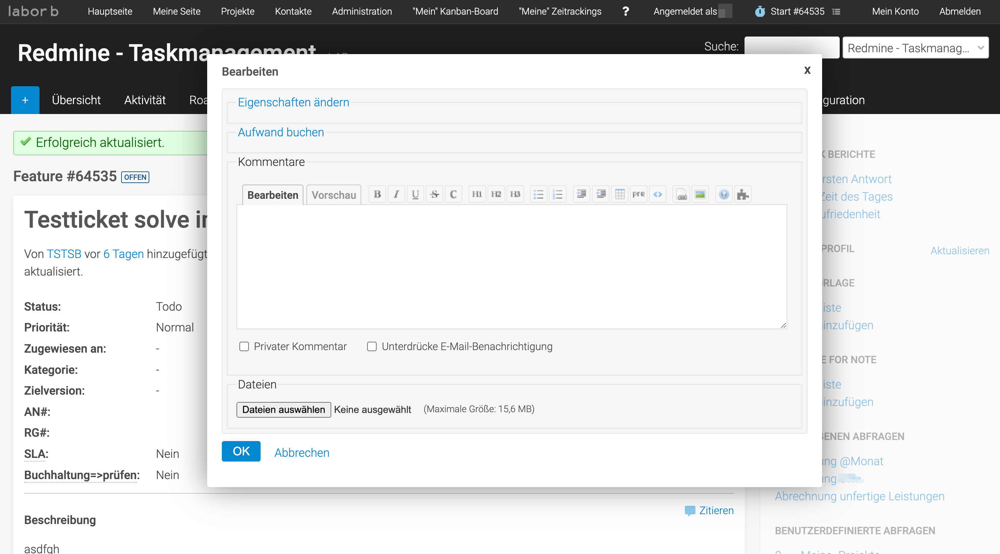

# Flat Theme for Redmine



## About

A modern, flat design theme for Redmine built with Sass. This fork includes improvements and bugfixes.

- Original repository: [tsi/redmine-theme-flat](https://github.com/tsi/redmine-theme-flat)
- Fork repository: [laborb/redmine-theme-flat](https://github.com/laborb/redmine-theme-flat)
- Documentation: [DEVELOPMENT.md](DEVELOPMENT.md)

## Requirements

- Redmine 3.x - 5.x
- For development: Node.js and npm

## Installation

### For Production Use

1. Download or clone this repository to your Redmine themes directory:
   ```bash
   cd redmine/public/themes/
   git clone https://github.com/laborb/redmine-theme-flat.git flat
   ```

2. Open Redmine in a browser and go to:
   **Administration → Settings → Display → Theme**

3. Select "Flat" from the dropdown and save

### For Development

See [DEVELOPMENT.md](DEVELOPMENT.md) for detailed development setup instructions.

Quick start:
```bash
./dev.sh start
```

## Customization

The theme is built with Sass, making customization easy.

- Colors are defined in `sass/application.scss`
- Edit `.scss` files in the `sass/` directory
- Compile with `npm run compile` or use watch mode: `npm run watch`

### Build Process

```bash
# Install dependencies
npm install

# Watch for changes (auto-compile)
npm run watch

# Compile once
npm run compile
```

## Notes and Specifics

- Theme uses Sass for stylesheets - edit `.scss` files, not `.css` files directly
- Compiled CSS is in `stylesheets/application.css`
- Modern flat design optimized for readability
- Responsive design for mobile devices

## Known Issues

- None currently

## Troubleshooting

See [DEVELOPMENT.md](DEVELOPMENT.md) for detailed troubleshooting.

## License

[WTFPL](http://www.wtfpl.net/)
